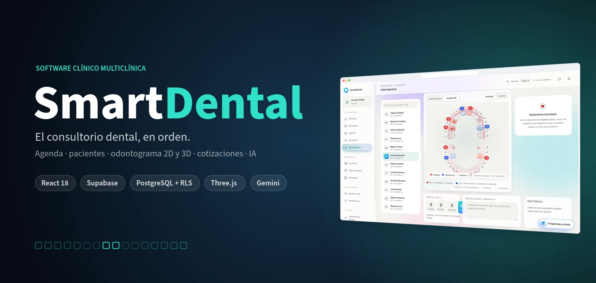
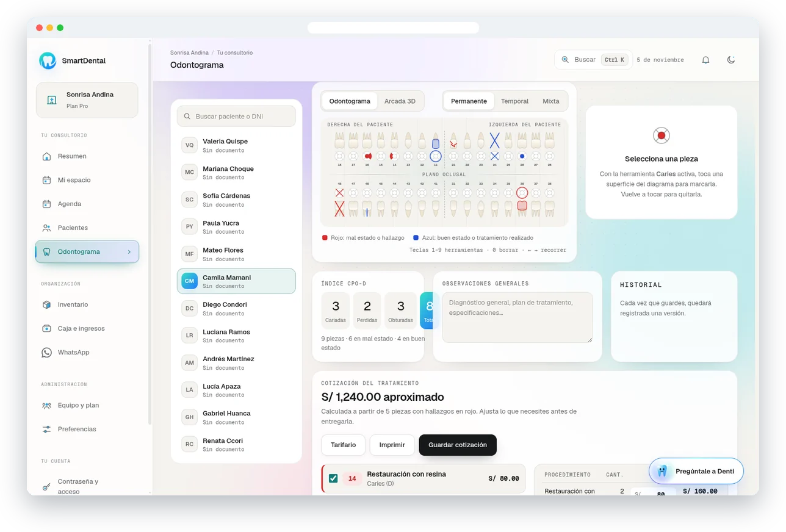
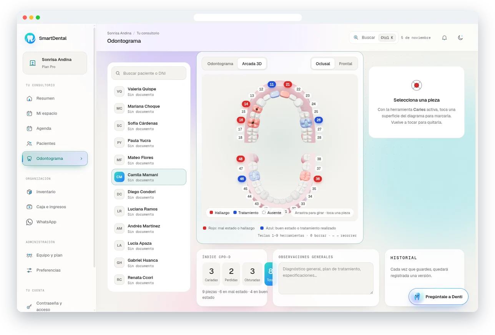
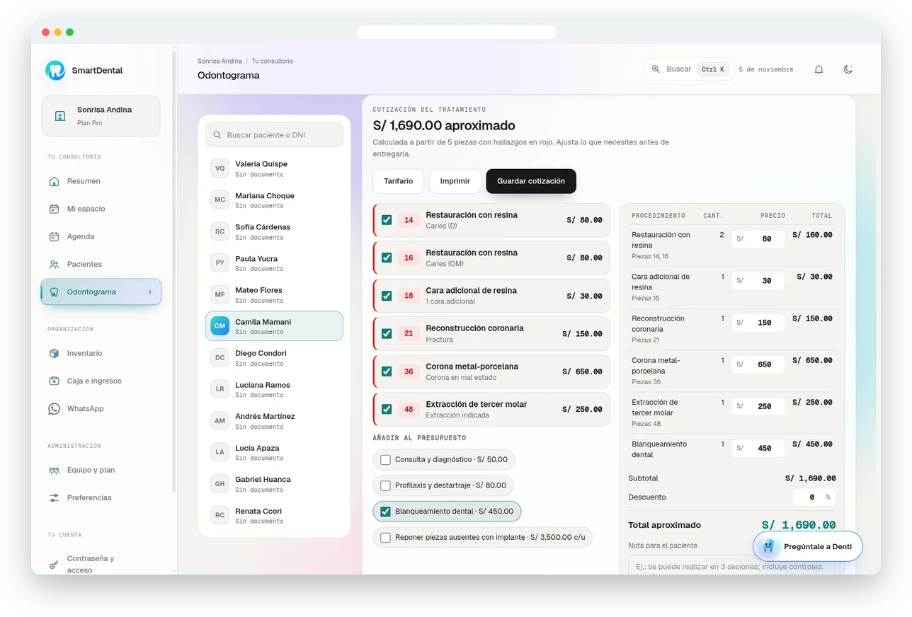
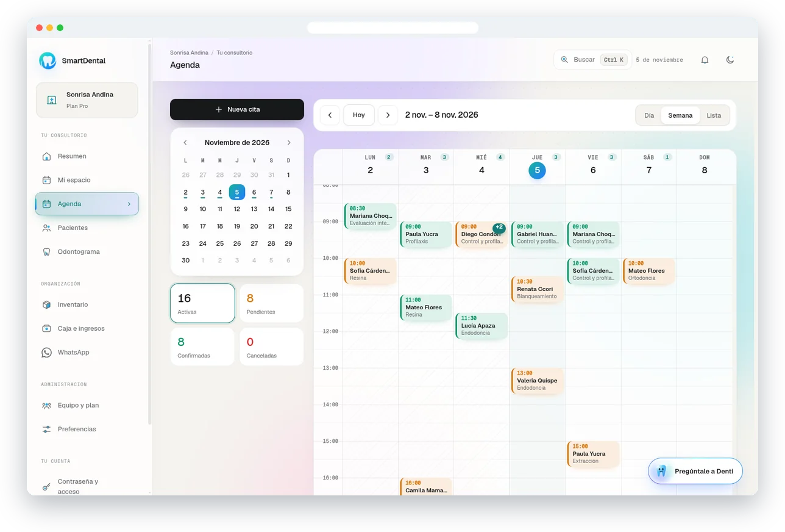
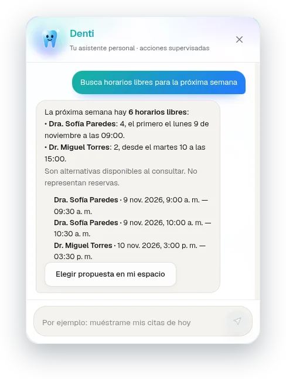
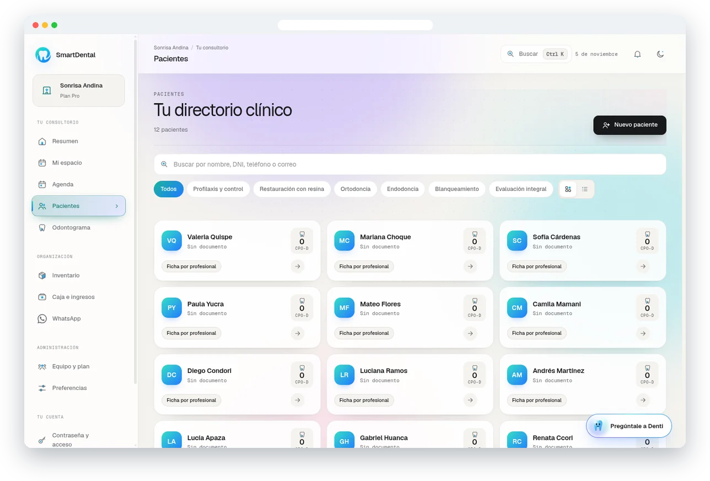
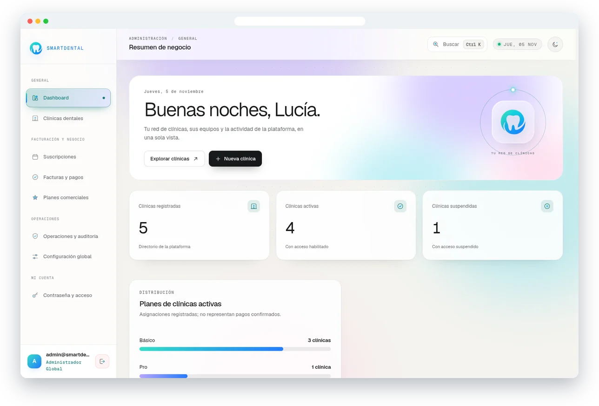
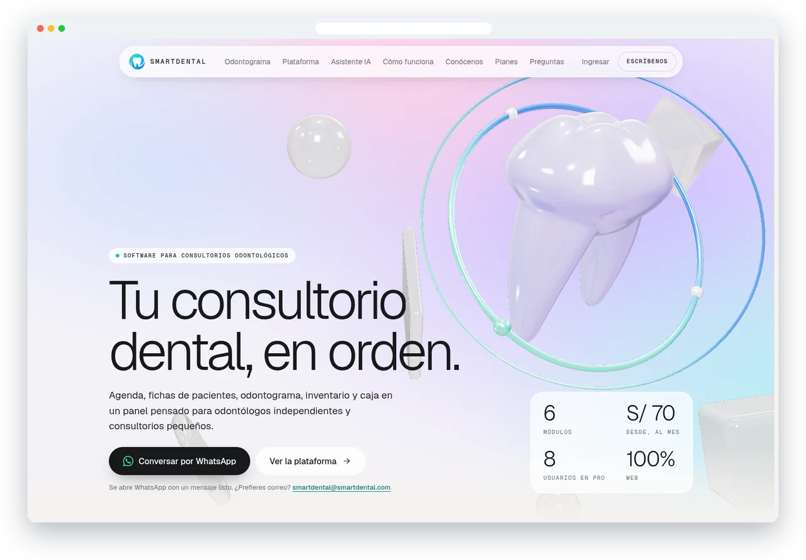
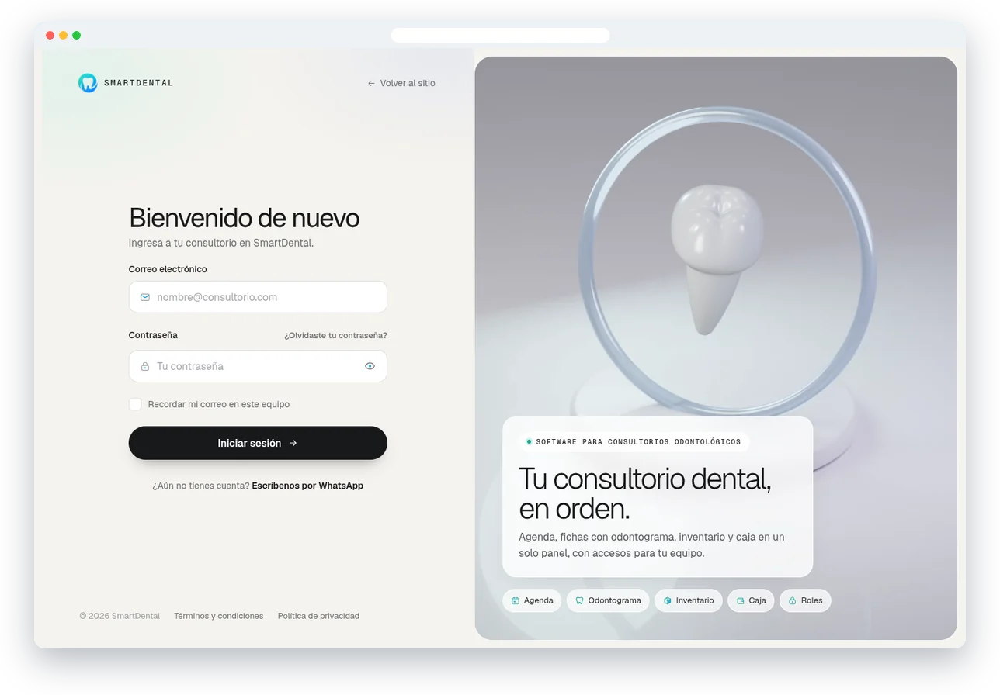

<div align="center">



<br />

**Agenda, pacientes, odontograma 2D y 3D, cotizaciones y un asistente con IA, en un solo sistema web.**<br />
Pensado para odontólogos independientes y consultorios pequeños que hoy trabajan con papel, Excel y un WhatsApp personal.

<br />


[Características](#-características) ·
[Seguridad](#-seguridad-por-diseño) ·
[Tecnologías](#-tecnologías) ·
[Cómo ejecutarlo](#-cómo-ejecutarlo) ·
[Estructura](#-estructura-del-proyecto)

</div>

---

## ✦ Por qué SmartDental

| Antes | Con SmartDental |
| --- | --- |
| Citas en un cuaderno; pacientes que olvidan su turno | Agenda compartida por profesional, con estados y disponibilidad real |
| Odontograma en una hoja suelta, sin historial | Odontograma digital FDI con historial, índices CPO-D / ceo-d y vista 3D |
| Presupuestos calculados de memoria | Cotización automática desde los hallazgos, con el tarifario de la clínica |
| Datos de todos los consultorios mezclados | Cada clínica con sus datos aislados en la propia base de datos |

---

## ✦ Características

### 🦷 Odontograma profesional, en 2D y en 3D

Notación **FDI** para dentición permanente, temporal o **mixta**; marcas por pieza y por cara siguiendo la convención clínica: **rojo** para hallazgos y **azul** para tratamientos realizados. Historial de versiones, índices **CPO-D** y **ceo-d**, deshacer y rehacer, atajos de teclado e impresión limpia. La arcada 3D colorea cada pieza según su estado y muestra su número.

<table>
  <tr>
    <td width="50%"></td>
    <td width="50%"></td>
  </tr>
</table>

### 🧾 Cotización automática desde el odontograma

Cada hallazgo en rojo se convierte en el procedimiento que lo resuelve (una caries en una resina, una fractura en una reconstrucción, una extracción indicada en una extracción…) con el **tarifario de la clínica**. Se pueden excluir líneas, sumar procedimientos propios como un blanqueamiento, aplicar un descuento e **imprimir el presupuesto en PDF** para el paciente. La copia queda guardada en su ficha.



> El tarifario se organiza por especialidad, permite subir o bajar todos los precios en un porcentaje y volver al precio referencial con un clic.

### 📅 Agenda que se lee de un vistazo

Vistas de día, semana y lista, filtro por profesional y reserva guiada con la **disponibilidad real** del odontólogo. Las citas que se superponen se agrupan en un indicador «+N» que abre la lista completa. En el móvil, la agenda aparece primero.



### 🤖 Denti, un asistente con IA que no improvisa

<table>
  <tr>
    <td width="38%"></td>
    <td>

Pregúntale como a un colega: *«busca horarios libres la próxima semana»*, *«¿cuántas citas siguen pendientes?»*. Denti razona con un modelo de lenguaje, pero solo obtiene datos a través de herramientas acotadas:

- **Usa tus permisos.** Lee la agenda con tu sesión: un odontólogo solo ve la suya.
- **Datos mínimos.** Al modelo nunca llegan DNI, teléfonos ni identificadores internos.
- **Tú confirmas.** No cambia citas por su cuenta; una cancelación es solo una propuesta.
- **Responde directo**, reconoce a los odontólogos por su nombre y escribe las fechas en lenguaje natural.

</td>
  </tr>
</table>

### 👥 Pacientes, inventario, caja y WhatsApp

Directorio con búsqueda por nombre o DNI y ficha clínica; inventario con **semáforo de stock mínimo**; caja de ingresos con exportación CSV protegida contra inyección de fórmulas; y bandeja de conversaciones de WhatsApp por profesional.



### 🏢 Consola de plataforma

Para quien administra SmartDental: alta y suspensión de clínicas, planes **Básico** y **Pro**, suscripciones, cobros, auditoría, exportación de datos por clínica y ajustes globales.



### ✨ Una experiencia cuidada

Sitio público con una pieza dental en 3D, inicio de sesión con render de estudio, **tema claro y oscuro** con transición animada, búsqueda rápida con <kbd>Ctrl</kbd> + <kbd>K</kbd>, diseño adaptable a escritorio, tableta y teléfono, y respeto por la preferencia de movimiento reducido.

<table>
  <tr>
    <td width="50%"></td>
    <td width="50%"></td>
  </tr>
</table>

---

## ✦ Seguridad por diseño

- **Aislamiento multiclínica en la base de datos.** Las políticas de seguridad a nivel de fila (RLS) de PostgreSQL limitan cada consulta a la clínica y al rol de quien la hace; ocultar un botón nunca es la única protección.
- **Roles con permisos distintos:** administrador de plataforma, administrador de clínica, odontólogo y recepcionista.
- **Sin secretos en el navegador.** El cliente solo usa la clave pública del proyecto; cualquier operación privilegiada se resuelve en el servidor.
- **Exportaciones seguras:** columnas permitidas de forma explícita y CSV sin fórmulas ejecutables.

| Rol | Qué puede hacer |
| --- | --- |
| Administrador de plataforma | Clínicas, planes, cobros, auditoría y ajustes globales |
| Administrador de clínica | Todo su consultorio: equipo, plan, tarifario, caja y módulos clínicos |
| Odontólogo | Su agenda, sus pacientes asignados, el odontograma y las cotizaciones |
| Recepcionista | Agenda, pacientes, inventario y conversaciones autorizadas |

---

## ✦ Tecnologías

| Capa | Tecnología |
| --- | --- |
| Interfaz | React 18, React Router 6, CSS con variables de tema, Tailwind CSS 4 |
| Construcción | Vite 5 |
| Datos y autenticación | Supabase (PostgreSQL con RLS, Auth, Storage, Realtime) |
| 3D y movimiento | Three.js, Framer Motion, Lenis, View Transitions API |
| Asistente | Modelo de lenguaje Gemini con herramientas de solo lectura |
| Notificaciones | Sileo |

---

## ✦ Cómo ejecutarlo

**Requisitos:** [Node.js](https://nodejs.org/) 20 o superior y [Git](https://git-scm.com/).

```bash
git clone https://github.com/garou7ro/SmartDental.git
cd SmartDental
npm install
npm run dev
```

Se abre [http://localhost:3000](http://localhost:3000). La aplicación ya viene conectada a su servicio en la nube: **no hace falta crear un archivo `.env`** ni configurar nada más.

> [!IMPORTANT]
> La aplicación debe ejecutarse en el puerto **3000** (o **3001**). Si el 3000 está ocupado por otro programa, ciérralo o usa `npm run dev -- --port 3001`.

> [!NOTE]
> Para ingresar se necesitan credenciales de una clínica. Las de demostración se entregan junto con el proyecto y no se publican en este repositorio.

| Comando | Qué hace |
| --- | --- |
| `npm run dev` | Servidor de desarrollo en el puerto 3000 |
| `npm run build` | Compilación de producción en `dist/` |
| `npm run preview` | Sirve la compilación de producción |

---

## ✦ Estructura del proyecto

```text
src/
├── pages/              Páginas: sitio público, acceso, consola y módulos de la clínica
├── features/           Secciones de la consola de plataforma y de WhatsApp
├── components/
│   ├── odontogram/     Odontograma 2D, cotización y tarifario
│   ├── assistant/      Denti, el asistente personal
│   ├── landing/        Sitio público, intro y arcada 3D
│   └── layout/         Estructura del panel, búsqueda rápida y efectos
├── lib/                Modelo del odontograma, cotizaciones, cliente de datos
├── hooks/              Consultas con cancelación y acciones protegidas
└── providers/          Sesión y tema
```

---

<div align="center">

Hecho por **Ronal Abelin Larico Ccaso** · Gestión de Proyectos · 2026<br />
Distribuido bajo la [licencia MIT](LICENSE).

</div>
