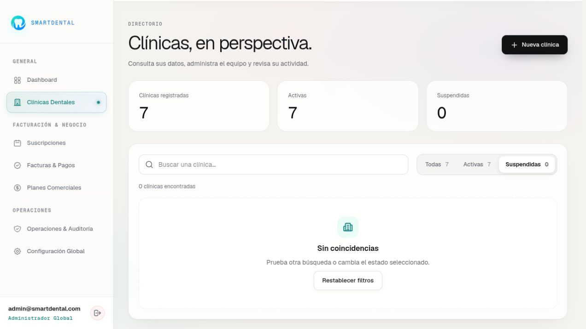

# SmartDental

Sistema integral de gestión para clínicas y consultorios odontológicos. Diseñado para optimizar la atención de pacientes, la organización clínica y la administración diaria de manera ágil y moderna.

---

## 📸 Capturas de pantalla

### Vista Principal


### Módulos y Servicios


### Acceso a la Plataforma


### Panel de Administración


---

## ✨ Funcionalidades

- **Agenda y Calendario de Citas:** Gestión visual de citas por profesional, control de estados (confirmada, atendida, reprogramada, cancelada) y filtros por día.
- **Odontograma Digital e Interactivo:** Marcación anatómica precisa en piezas dentales para diagnósticos, tratamientos y evoluciones clínicas.
- **Directorio e Historial de Pacientes:** Fichas clínicas completas, antecedentes médicos y seguimiento detallado de tratamientos.
- **Control de Inventario:** Registro y monitoreo de insumos odontológicos, entradas, salidas y alertas de stock bajo.
- **Finanzas y Facturación:** Registro de ingresos, gastos, métodos de pago y balance financiero de la clínica.
- **Integración de WhatsApp:** Canales de comunicación directa para confirmación de citas y atención al paciente.
- **Gestión Multi-rol:** Perfiles adaptados con permisos específicos para Administradores, Odontólogos y Personal de Recepción/Asistentes.

---

## 🚀 Instalación y Ejecución

### Prerrequisitos
- [Node.js](https://nodejs.org/) (versión 18 o superior recomendada)
- `npm` o `pnpm` / `yarn`

### Pasos

1. **Clonar el repositorio:**
   ```bash
   git clone https://github.com/garou7ro/SmartDental.git
   cd SmartDental
   ```

2. **Instalar dependencias:**
   ```bash
   npm install
   ```

3. **Iniciar el servidor de desarrollo:**
   ```bash
   npm run dev
   ```
   Abre [http://localhost:5173](http://localhost:5173) en tu navegador para ver la aplicación en ejecución.

4. **(Opcional) Configuración de variables de entorno:**
   Si deseas utilizar tu propia instancia de base de datos o canales personalizados:
   ```bash
   cp .env.example .env
   ```

5. **Compilar para producción:**
   ```bash
   npm run build
   ```
   Los archivos estáticos generados se guardarán en el directorio `dist/`.

---

## 📄 Licencia

Este proyecto está bajo la Licencia MIT - Autor: [garou7ro](https://github.com/garou7ro). Consulta el archivo [LICENSE](LICENSE) para más información.
