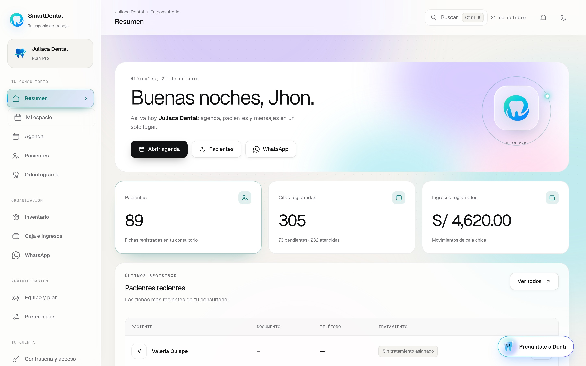
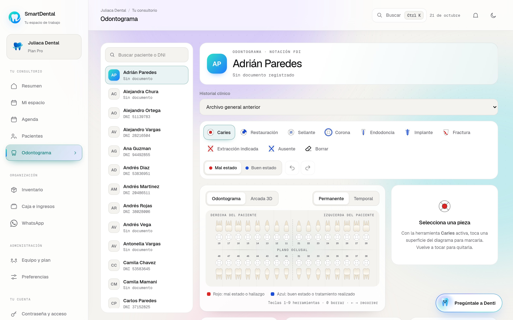
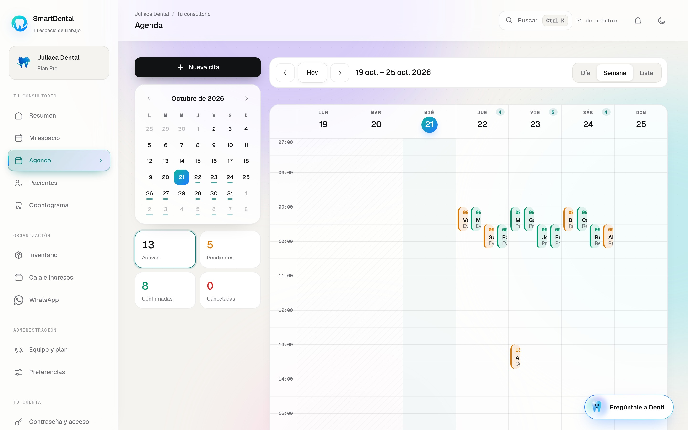
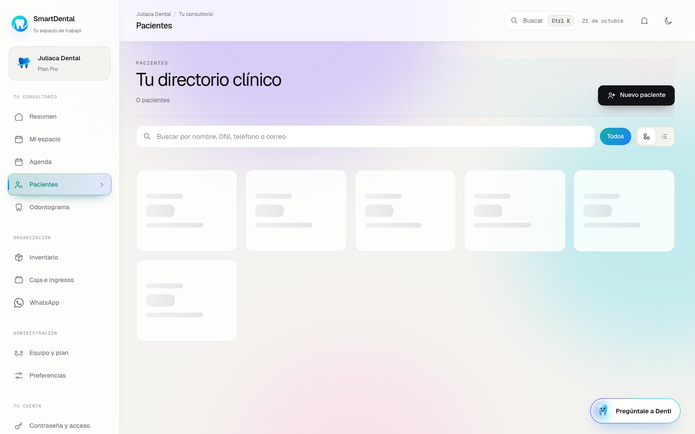
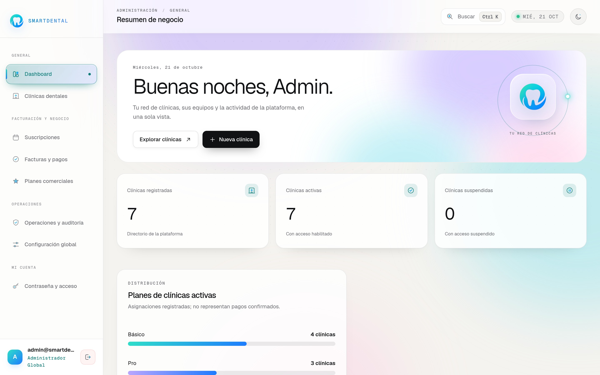

# SmartDental

Sistema integral de gestión para clínicas y consultorios odontológicos. Diseñado para optimizar la atención de pacientes, la organización clínica y la administración diaria de manera ágil y moderna.

---

## 📸 Capturas de pantalla

### Vista Principal & Presentación


### Módulos y Servicios


### Panel Clínico - Resumen de Operaciones


### Odontograma Digital e Interactivo


### Agenda y Calendario de Citas


### Directorio de Pacientes


### Panel de Administración Global


---

## ✨ Funcionalidades

- **Agenda y Calendario de Citas:** Gestión visual de citas por profesional, control de estados (confirmada, atendida, reprogramada, cancelada) y filtros por día.
- **Odontograma Digital e Interactivo:** Marcación anatómica precisa en piezas dentales para diagnósticos, tratamientos y evoluciones clínicas.
- **Directorio e Historial de Pacientes:** Fichas clínicas completas, antecedentes médicos y seguimiento detallado de tratamientos.
- **Control de Inventario:** Registro y monitoreo de insumos odontológicos, entradas, salidas y alertas de stock bajo.
- **Finanzas y Facturación:** Registro de ingresos, gastos, métodos de pago y balance financiero de la clínica.
- **Integración de WhatsApp:** Canales de comunicación directa para confirmación de citas y atención al paciente.
- **Gestión Multi-rol:** Perfiles adaptados con permisos específicos para Administradores de clínica, Odontólogos y Personal de Recepción/Asistentes.

---

## 🚀 Instalación y Ejecución

### Prerrequisitos
- [Node.js](https://nodejs.org/) 20 o superior (incluye `npm`)
- [Git](https://git-scm.com/)

### Pasos

1. **Clonar el repositorio:**
   ```bash
   git clone https://github.com/garou7ro/SmartDental.git
   cd SmartDental
   ```

2. **Instalar dependencias:**
   ```bash
   npm install
   ```

3. **Iniciar la aplicación:**
   ```bash
   npm run dev
   ```
   Se abre [http://localhost:3000](http://localhost:3000) en el navegador. La aplicación ya viene conectada a su servicio en la nube: no hace falta crear un archivo `.env` ni configurar nada más.

   > La aplicación debe ejecutarse en el puerto **3000** (o **3001**). Si el 3000 está ocupado por otro programa, ciérralo o usa `npm run dev -- --port 3001`.

4. **Ingresar:** usa las credenciales de acceso entregadas junto con el proyecto.

5. **Compilar para producción:**
   ```bash
   npm run build
   ```
   Los archivos estáticos generados se guardarán en el directorio `dist/`.

---

## 📄 Licencia

Este proyecto está bajo la Licencia MIT - Autor: [garou7ro](https://github.com/garou7ro). Consulta el archivo [LICENSE](LICENSE) para más información.
